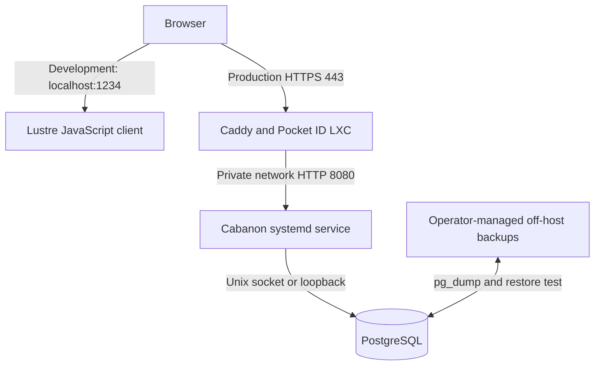

# Architecture

## Decision

Cabanon is a **modular monolith** split into three Gleam packages: `client/` targets JavaScript and contains the Lustre browser UI, `shared/` contains pure domain rules, and the repository root targets Erlang for the HTTP server. The server is deployed directly as an Erlang shipment in a private Proxmox LXC and supervised by systemd. PostgreSQL runs in the same LXC and is reachable only through a Unix socket or `127.0.0.1`. A separate, public Caddy LXC terminates TLS and reverse-proxies requests to the application LXC over a private network.

The client and server both depend on `shared/`, so household contribution and actual construction-cost rules are implemented once and compiled for both targets. The Erlang server exposes household and construction JSON APIs backed by PostgreSQL. The Lustre client loads both datasets on startup and automatically saves the current household budget after a short pause; reviewed monthly contribution snapshots are saved only through an explicit action and remain separate from autosave. Construction history is also persisted through the API. The production release bundles the compiled Lustre assets and the Erlang server serves them from `/opt/cabanon/current/frontend`.

A Gleam application targeting Erlang is not a standalone native executable. The deployable release bundle contains the BEAM shipment, frontend, migrations, systemd unit, and installer scripts. The target application LXC must run Debian 13 Erlang/OTP `27.3.4.1`; the installer and deploy script verify this runtime and release checksums. This is intentionally simpler than introducing Docker or another container runtime.

## Why this shape

A personal finance application benefits more from understandable operations and recoverability than from service independence. Gleam provides type-safe boundaries while the Erlang runtime provides lightweight concurrency. The domain is split into modules, not deployable services:

- `shared/src/cabanon/domain/household`: expenses, residents, contribution calculation, settlement rules.
- `shared/src/cabanon/domain/construction`: actual cost validation, totals, and category aggregation; estimates and forecasts are future work.
- `client/`: Lustre views and browser interaction, compiled to JavaScript.
- `src/cabanon/web`: Erlang HTTP parsing, static frontend serving, health and readiness routes, Origin guard, and API routes.
- `src/cabanon/persistence`: PostgreSQL adapters; SQL stays outside the shared domain.

Both adapters depend inward on `shared`; domain modules must not import either adapter.

## Network and trust boundaries

| Component | Network exposure | Required controls |
| --- | --- | --- |
| Caddy and Pocket ID LXC | Public TCP 80/443 only | Pocket ID authenticates the single user before proxying; TLS, HTTP security headers, rate limits, and access logs are operator-managed |
| Application server | Configured private `CABANON_BIND_ADDRESS:CABANON_PORT` | Firewall allow-list Caddy only; production requires `CABANON_ALLOWED_ORIGIN`; unsafe methods require an exact Origin match |
| PostgreSQL | No routed TCP exposure | `listen_addresses = '127.0.0.1'`, Unix socket, `scram-sha-256`, separate application role |
| Backups | Outbound only to an operator-selected backup target | Encryption, retention, monitoring, and restore verification are required before production but not automated by this repository |

## Important trade-off

Putting PostgreSQL in the application LXC is appropriate for a small personal deployment and does reduce network exposure. It **does not isolate failures**: a compromised or resource-starved LXC affects both application and database. This is acceptable only with LXC snapshots, off-host encrypted backups, memory limits, and a tested recovery procedure. Move PostgreSQL to a dedicated private LXC if availability, multiple applications, or heavier data workloads become important.

## Remaining operational work

1. Configure Caddy and Pocket ID for the actual domain, private upstream, TLS, headers, rate limits, and Caddy-only firewall access.
2. Configure encrypted off-host PostgreSQL backups, retention, monitoring, and regular restore tests; this remains operator-specific.
3. Extend the explicit correction and audit-history pattern to household financial records, without silently deleting them.
4. Add application-level identity mapping and household-scoped authorization before supporting more than one user.
