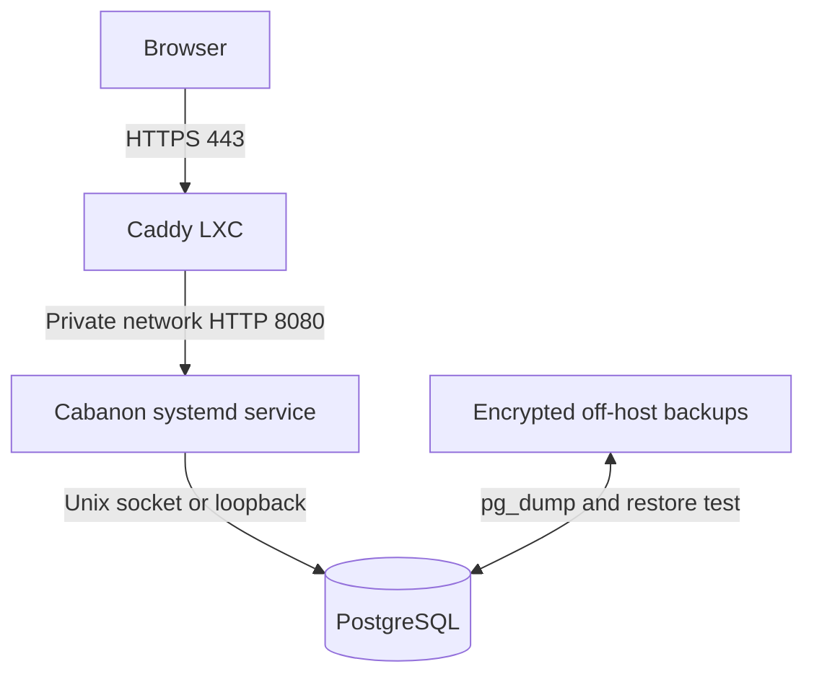

# Architecture

## Decision

Cabanon is a **modular monolith** compiled by Gleam to Erlang. The application is deployed directly as an Erlang shipment in a private Proxmox LXC and supervised by systemd. PostgreSQL runs in the same LXC and is reachable only through a Unix socket or `127.0.0.1`. A separate, public Caddy LXC terminates TLS and reverse-proxies requests to the application LXC over a private network.

A Gleam application targeting Erlang is not a standalone native executable. The deployable artifact is an archive containing BEAM bytecode and an `entrypoint.sh`; the application LXC must provide a compatible Erlang/OTP runtime. This is intentionally simpler than introducing Docker or another container runtime.

## Why this shape

A personal finance application benefits more from understandable operations and recoverability than from service independence. Gleam provides type-safe boundaries while the Erlang runtime provides lightweight concurrency. The domain is split into modules, not deployable services:

- `domain/household`: expenses, residents, contribution calculation, settlement rules.
- `domain/construction`: estimates, invoices, actual spend, and forecast.
- `web`: HTTP parsing, authentication, authorization, CSRF protection, and views.
- future `persistence`: PostgreSQL repositories and migrations.

Dependencies point inward: `web` and `persistence` may call `domain`; domain modules must not import either adapter.

## Network and trust boundaries

| Component | Network exposure | Required controls |
| --- | --- | --- |
| Caddy LXC | Public TCP 80/443 only | Automatic TLS, HTTP security headers, rate limits, access logs |
| Application LXC | TCP 8080 from Caddy LXC IP only | Proxmox firewall allow-list, systemd service under a dedicated non-login user |
| PostgreSQL | No routed TCP exposure | `listen_addresses = '127.0.0.1'`, Unix socket, `scram-sha-256`, separate application role |
| Backups | Outbound only to backup target | Encryption, retention, restore verification |

## Important trade-off

Putting PostgreSQL in the application LXC is appropriate for a small personal deployment and does reduce network exposure. It **does not isolate failures**: a compromised or resource-starved LXC affects both application and database. This is acceptable only with LXC snapshots, off-host encrypted backups, memory limits, and a tested recovery procedure. Move PostgreSQL to a dedicated private LXC if availability, multiple applications, or heavier data workloads become important.

## Next implementation slices

1. Add PostgreSQL migrations and a repository interface without leaking SQL into domain modules.
2. Add local password authentication with Argon2id, secure session cookies, CSRF middleware, and login throttling.
3. Deliver household expenses end-to-end before starting construction-budget screens.
4. Add append-only audit events for financial changes and exports.
