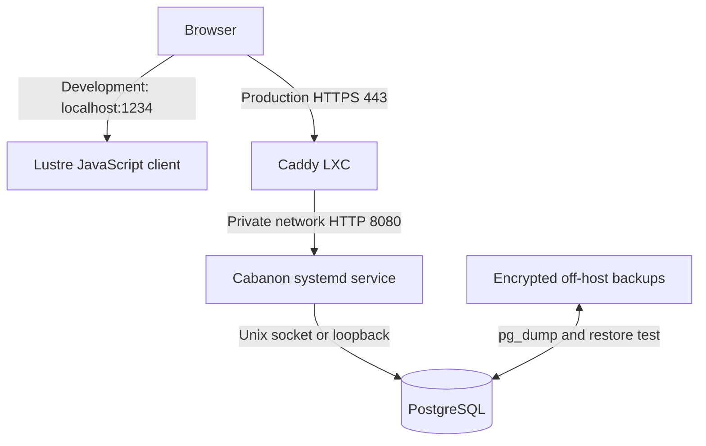

# Architecture

## Decision

Cabanon is a **modular monolith** split into three Gleam packages: `client/` targets JavaScript and contains the Lustre browser UI, `shared/` contains pure domain rules, and the repository root targets Erlang for the HTTP server. The server is deployed directly as an Erlang shipment in a private Proxmox LXC and supervised by systemd. PostgreSQL runs in the same LXC and is reachable only through a Unix socket or `127.0.0.1`. A separate, public Caddy LXC terminates TLS and reverse-proxies requests to the application LXC over a private network.

The client and server both depend on `shared/`, so household contribution and actual construction-cost rules are implemented once and compiled for both targets. The current Lustre development server serves the client on port 1234; production bundling and serving those assets through the Erlang server are not wired up yet. Client state, including construction history and custom categories, is in memory and resets on reload.

A Gleam application targeting Erlang is not a standalone native executable. The deployable backend artifact is an archive containing BEAM bytecode and an `entrypoint.sh`; the application LXC must provide a compatible Erlang/OTP runtime. This is intentionally simpler than introducing Docker or another container runtime.

## Why this shape

A personal finance application benefits more from understandable operations and recoverability than from service independence. Gleam provides type-safe boundaries while the Erlang runtime provides lightweight concurrency. The domain is split into modules, not deployable services:

- `shared/src/cabanon/domain/household`: expenses, residents, contribution calculation, settlement rules.
- `shared/src/cabanon/domain/construction`: actual cost validation, totals, and category aggregation; estimates and forecasts are future work.
- `client/`: Lustre views and browser interaction, compiled to JavaScript.
- `src/cabanon/web`: Erlang HTTP parsing, authentication, authorization, CSRF protection, and API routes.
- future persistence adapters: PostgreSQL repositories and migrations.

Both adapters depend inward on `shared`; domain modules must not import either adapter.

## Network and trust boundaries

| Component | Network exposure | Required controls |
| --- | --- | --- |
| Caddy LXC | Public TCP 80/443 only | Automatic TLS, HTTP security headers, rate limits, access logs |
| Application LXC | TCP 8080 from Caddy LXC IP only | Proxmox firewall allow-list, systemd service under a dedicated non-login user |
| PostgreSQL | No routed TCP exposure | `listen_addresses = '127.0.0.1'`, Unix socket, `scram-sha-256`, separate application role |
| Backups | Outbound only to backup target | Encryption, retention, restore verification |

## Important trade-off

Putting PostgreSQL in the application LXC is appropriate for a small personal deployment and does reduce network exposure. It **does not isolate failures**: a compromised or resource-starved LXC affects both application and database. This is acceptable only with LXC snapshots, off-host encrypted backups, memory limits, and a tested recovery procedure. Move PostgreSQL to a dedicated private LXC if availability, multiple applications, or heavier data workloads become important.

## Next implementation slices

1. Serve the built Lustre assets through the Erlang application and add narrow APIs for household and construction data.
2. Add PostgreSQL migrations and repository interfaces without leaking SQL into domain modules.
3. Add authentication before storing household financial data across sessions.
4. Persist household expenses and actual construction costs, with explicit correction workflows for financial history.
